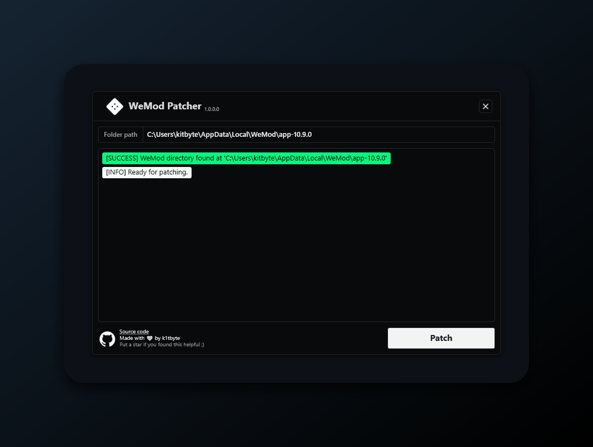
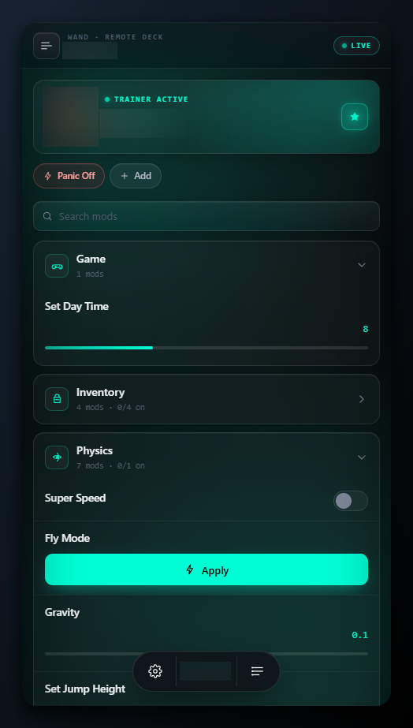

> [!IMPORTANT]
> **Credits & Attribution / Kaynak ve Bilgi:**
> * **EN:** This repository is a complete, buildable source-code restoration based on the original **[k1tbyte/Wand-Enhancer](https://github.com/k1tbyte/Wand-Enhancer)** project (v2.2.1.0). The original upstream repository intentionally omitted several files required for compilation; those missing parts have been fixed and restored here so anyone can audit and build the project from source. **No pre-compiled binaries (.exe / .dll) are distributed.** All original credits go to **[k1tbyte](https://github.com/k1tbyte)**.
> * **TR:** Bu depo, **[k1tbyte/Wand-Enhancer](https://github.com/k1tbyte/Wand-Enhancer)** (v2.2.1.0) projesinin eksik bırakılan kaynak kodlarının tamamlanmış ve doğrudan derlenebilir hale getirilmiş versiyonudur. İçerisinde önceden derlenmiş .exe veya .dll dosyaları bulunmaz; herkesin kodu inceleyip kendi bilgisayarında derleyebilmesi amacıyla paylaşılmıştır. Orijinal proje **[k1tbyte](https://github.com/k1tbyte)** tarafından geliştirilmiştir.

---

# WandEnhancer

An open-source tool that extends the local client-side configuration of the Wand app and improves its UX.

> **Note:** This repository contains source code only and distributes no pre-built `.exe` files. Users must compile the project themselves from source.

## Features

- Local environment configuration management
- Automated compatibility adjustments for new client versions
- Layout and theme customization (client side only)
- AI features
- Remote web panel: control Wand from your phone

## Network and privacy

The patcher modifies files in the selected local Wand installation. By default it has no update check and no telemetry. Wand itself stays an online application. The optional remote web panel starts a LAN HTTP/WebSocket server and uses Wand API and CDN data, such as trainer translations and artwork.

## Build from source (Nasıl Derlenir?)

You need Windows with **Node.js** and `pnpm`, **Visual Studio 2022** (or Build Tools with `MSBuild`), and the **.NET Framework 4.8** desktop build tools / targeting pack.

1. Clone or download this repository.
2. Run `build.cmd` from Command Prompt or PowerShell (or open `Wand-Enhancer.sln` in Visual Studio and build in `Release` mode).
3. The compiled executable will be generated in `WandEnhancer\bin\Release\WandEnhancer.exe`.

## Remote web panel

The panel lets you control Wand from your phone.

1. Put the PC and the phone on the same Wi-Fi network.
2. Hover over **Connect** in the top bar of WandEnhancer.
3. Scan the QR code with your phone camera.

If the page does not load:

- Some routers and guest Wi-Fi networks isolate clients (AP isolation), so devices on one network cannot reach each other.
- Allow inbound TCP port `3223` for your local network in Windows Firewall. If Windows marked the connection as Public, switching it to Private can also help.
- To use the panel over mobile data or from another network, use a VPN such as [Tailscale](https://tailscale.com/).

## Custom scripts

You can inject your own JavaScript into Wand at patch time. Scripts use the same renderer injection as the remote web panel, so the remote web panel patch must be enabled.

To add a script, pick one or more `.js` files in the patch dialog (only existing `.js` files are accepted), or put them in a `renderer-scripts/` folder next to the patcher executable. Then patch as usual and the scripts are bundled into the client.

## Screenshots

## License

Apache-2.0, see [LICENSE](LICENSE.md).

---

> **Legal disclaimer:** This project is a third-party enhancement tool intended solely for educational, research and local interoperability purposes. It does not distribute any proprietary code or bypass server-side validations. All modifications are performed locally to customize the user's interface.